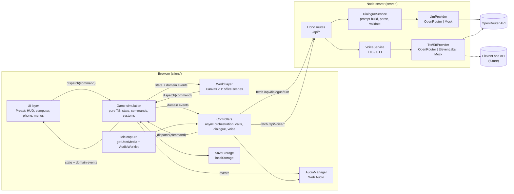
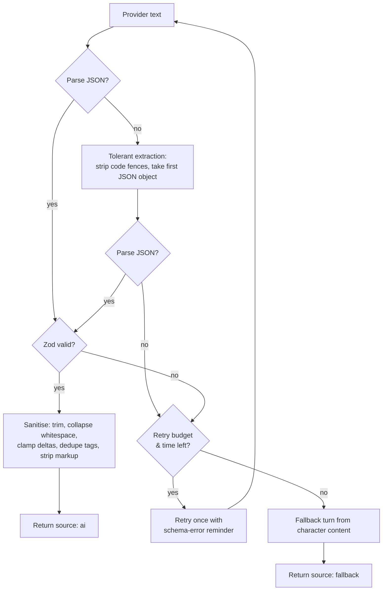
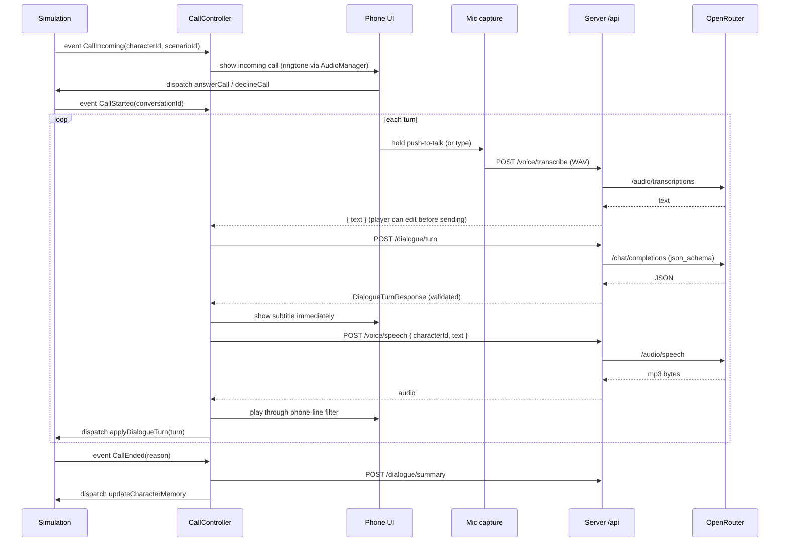
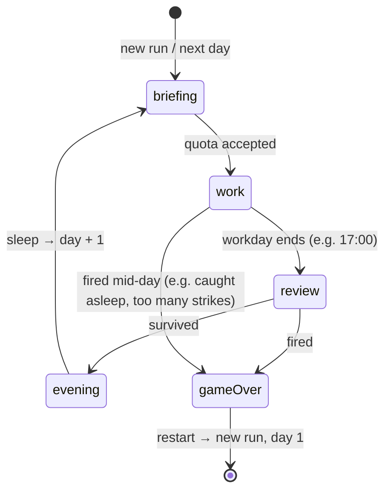

# ARCHITECTURE.md

> **Status:** Phase 2 (Design) complete — this is the technical source of truth. Nothing described here is implemented yet unless the [Implementation status](#implementation-status) table says so.
>
> **Working identifier:** `untitled-office-game` (temporary; not a name, see [§1.4](#14-naming)).
>
> **Last revised:** 2026-11-26

This document explains how the game is built, why it is built that way, and in what order it gets built. Read it in full before making architectural changes. Visual and interaction rules live in [DESIGN.md](DESIGN.md); engineering rules for contributors and coding agents live in [AGENTS.md](AGENTS.md).

---

## Contents

1. [Project overview](#1-project-overview)
2. [Technology stack and reasoning](#2-technology-stack-and-reasoning)
3. [Overall system architecture](#3-overall-system-architecture)
4. [Frontend architecture](#4-frontend-architecture)
5. [Rendering architecture](#5-rendering-architecture)
6. [Backend architecture](#6-backend-architecture)
7. [AI and OpenRouter integration](#7-ai-and-openrouter-integration)
8. [Voice and TTS architecture](#8-voice-and-tts-architecture)
9. [Game-state management](#9-game-state-management)
10. [Data models](#10-data-models)
11. [Character data structure](#11-character-data-structure)
12. [Save-game architecture](#12-save-game-architecture)
13. [Environment configuration](#13-environment-configuration)
14. [Security considerations](#14-security-considerations)
15. [Error handling](#15-error-handling)
16. [Testing strategy](#16-testing-strategy)
17. [Deployment considerations](#17-deployment-considerations)
18. [Performance considerations](#18-performance-considerations)
19. [Technical risks](#19-technical-risks)
20. [Development roadmap](#20-development-roadmap)
21. [Unresolved decisions](#21-unresolved-decisions)
22. [Decision log](#22-decision-log)

---

## 1. Project overview

### 1.1 What we are building

A free, open-source, single-player, browser-based 2D pixel-art office simulation with dark comedy and absurd humour. The player works a desk job in a morally dubious, entirely fictional call-centre operation. Each in-game day they receive a quota from their boss, use their office computer and phone to deal with a cast of AI-driven characters, manage their energy with coffee, and try to survive the end-of-day performance review. Get fired and the run ends; the next run starts again from day one.

The game is *inspired by the general concept* of social, conversation-driven office games such as *Scam With Your Friends*. It shares no assets, branding, names, characters or distinctive content with any existing game.

### 1.2 Pillars

| Pillar | Meaning for engineering |
|---|---|
| **Conversations are the core verb** | The dialogue/call pipeline must be robust, fast and degrade gracefully. It gets the most engineering attention. |
| **The game owns the rules** | AI produces flavour and *proposals*. Deterministic game code decides every outcome (trust changes, quotas, firing). |
| **Playable without AI or voice** | Every AI-backed feature has an offline fallback. Microphone and TTS are optional enhancements. |
| **Cohesive, hand-made feel** | One pixel scale, one palette, one component library. See [DESIGN.md](DESIGN.md). |
| **Cheap to run, easy to host** | One small Node service plus static files. No database. Low per-conversation cost. |

### 1.3 Scope boundaries

* Single-player only. No accounts, no multiplayer, no server-side game state.
* Desktop browsers first (Chromium, Firefox, Safari — current and previous major versions). Touch input should work for basic clicks but mobile layout is not a v1 goal (see [§21](#21-unresolved-decisions)).
* English only for v1.
* No unrestricted movement or 3D. The office is a set of point-and-click locations.

### 1.4 Naming

The game has no name yet. Until branding is decided, all code, package names, storage keys and documents use the working identifier `untitled-office-game` (short prefix `uog`). Do not invent a game title in code, UI copy or docs. When a name is chosen, the rename is a single tracked task; storage keys keep the `uog` prefix forever to avoid breaking saves (see [§12](#12-save-game-architecture)).

### 1.5 Content and tone boundaries

The premise is satire. These boundaries are architectural constraints because they are enforced in prompts, content data and review, not only in writing style:

* All organisations, products, places, people and institutions are **fictional**. No real companies, banks, government agencies, brands, celebrities or private individuals.
* The game never asks for, stores or transmits **real personal data**. In-world "account numbers", "passwords" etc. are visibly fake, game-generated tokens.
* Persuasion outcomes are **game mechanics** (trust/suspicion numbers), not a tutorial. Content must not contain realistic, transferable fraud instructions (real payment rails, real verification bypasses, real scripts targeting real institutions).
* The humour punches at the absurdity of corporate life and the operation itself, not at vulnerable groups.
* AI characters stay in-world, refuse to become general-purpose assistants and keep replies short.

---

## 2. Technology stack and reasoning

### 2.1 Summary

| Concern | Choice | Status |
|---|---|---|
| Language | **TypeScript** (strict) everywhere | Decided |
| Runtime (server, tooling) | **Node.js 24 LTS or newer** | Decided |
| Package manager | **npm** (ships with Node; no extra tool) | Decided |
| Build / dev server | **Vite** | Decided |
| UI layer (HUD, computer, phone, menus) | **Preact** + TSX, rendered to the DOM | Decided |
| World rendering (office scenes) | **Custom Canvas 2D renderer** (no game engine) | Decided |
| Game simulation | **Plain TypeScript**, framework-free, deterministic | Decided |
| Game-state store | **Custom minimal store** (immutable state + subscribe) | Decided |
| Validation / schemas | **Zod 4** (shared client + server; also generates JSON Schema for AI structured output) | Decided |
| Backend framework | **Hono** on `@hono/node-server` | Decided |
| LLM provider | **OpenRouter** Chat Completions API via `fetch` (no SDK) | Decided |
| Default dialogue model | `anthropic/claude-haiku-5.5` (via OpenRouter) | Provisional — validate in Phase 5 |
| TTS | **OpenRouter `/audio/speech`** with `hexgrad/kokoro-82m`; browser `speechSynthesis` as fallback; ElevenLabs as a future adapter | Provisional — validate in Phase 6 |
| STT | Push-to-talk → **OpenRouter `/audio/transcriptions`** (`openai/whisper-large-v3-turbo`); typed input always available | Provisional — validate in Phase 6 |
| Browser audio | **Web Audio API** (SFX, music, voice playback, phone-line filter); `getUserMedia` + `AudioWorklet` for mic capture | Decided |
| Persistence | **`localStorage`** behind a `SaveStorage` interface; JSON export/import | Decided |
| Unit / integration tests | **Vitest** | Decided |
| End-to-end tests | **Playwright** (from Phase 3) | Decided |
| Lint / format | **ESLint** (typescript-eslint) + **Prettier** | Decided |
| CI | **GitHub Actions** | Decided |
| Deployment | **Single Docker container** (Node serves API + static client); optional static-only build with AI disabled | Decided; host provider unresolved |
| Licence | **MIT** | Decided (asset licence: see §21) |

**Runtime dependency budget for v1:** `preact`, `hono`, `@hono/node-server`, `zod`. Anything else at runtime needs a written justification in the [decision log](#22-decision-log).

### 2.2 Why no game engine (Phaser, PixiJS, Kaplay, Godot web export)

The game is **UI-heavy and world-light**. Most play time is spent in text-rich interfaces (computer applications, phone calls, dialogue, ledgers), while the "world" is a handful of mostly static pixel-art rooms with clickable objects and some ambient animation.

* **Phaser** brings a scene graph, physics, input and its own UI model. We would use perhaps 10% of it, and its in-canvas UI is a poor fit for scrollable lists, text input, accessibility and forms — exactly what our computer apps need. It would push us into either building UI inside Phaser (painful) or bridging two UI systems (complex). ~1 MB of dependency for features we do not need.
* **PixiJS** is a renderer only and would be a reasonable choice for thousands of sprites or shader effects. We need neither; Canvas 2D at 640×360 with tens to low hundreds of sprites is trivially fast on every target device.
* **Godot / Unity web exports** produce large downloads, slow start-up, awkward DOM/text integration and a desktop-game toolchain, which the brief explicitly asks us to avoid.
* **Custom Canvas 2D** for the world (a few hundred lines: loop, sprite drawing, animation, hit-testing) plus **DOM for UI** gives us crisp pixel art, real text rendering, native input/accessibility, trivial testing with Playwright, and zero engine lock-in.

**Revisit trigger:** if Phase 9 polish needs large numbers of particles, lighting shaders or post-processing that Canvas 2D cannot do at 60 fps, swap the world renderer for PixiJS behind the same `Renderer` interface ([§5.2](#52-renderer-interface)). The UI layer is unaffected.

### 2.3 Why Preact (and not React, Svelte, Solid or vanilla DOM)

* The UI layer has many independent screens and apps with local state: a component model is genuinely useful; vanilla DOM would mean writing our own.
* **Preact** gives the React component/hooks model (which every contributor and coding agent knows well) at ~4 KB gzipped versus ~45 KB for React DOM.
* Svelte and Solid are excellent but less universally familiar and change the mental model (compiler, fine-grained reactivity). Familiarity matters for an open-source project worked on by many agents.
* We use Preact **only for the UI layer**. The game simulation never imports Preact.

### 2.4 Why a custom store (and not Redux, Zustand, XState or signals)

The authoritative game state is owned by the simulation, not by the UI. It needs: an immutable snapshot, a `dispatch(command)` entry point, typed domain events, and `subscribe` for the UI. That is ~100 lines of code. A Preact hook (`useGameSelector`) built on `useSyncExternalStore` semantics connects it to components. External state libraries would add dependencies and blur the line between UI state and game state. Short-lived UI state (which tab is open, a text field's value) stays in component state.

### 2.5 Why Hono + Node (and not Express, Fastify, Next.js or serverless-only)

* **Hono** is small, typed, built on Web-standard `Request`/`Response`, and runs on Node, Bun, Deno, Cloudflare Workers and others. That keeps hosting options open at no cost.
* Express is older, untyped and slower; Fastify is fine but heavier and Node-specific.
* **Next.js** or similar full-stack frameworks are designed for page-based web apps with SSR; a canvas game needs none of that.
* The server is a thin, stateless **AI/voice gateway**. It holds no game state and no database.

### 2.6 Why OpenRouter for LLM, TTS and STT

* The brief mandates OpenRouter for dialogue. As of November 2026 OpenRouter also exposes OpenAI-compatible **speech** (`/api/v1/audio/speech`) and **transcription** (`/api/v1/audio/transcriptions`) endpoints, including `hexgrad/kokoro-82m` (~$0.99 per million characters at time of writing) and several ElevenLabs models.
* One provider, one key, one billing account and one error-handling path for all AI features. Model choice is pure configuration.
* We call OpenRouter with `fetch`. Its API is OpenAI-compatible JSON; an SDK would add a dependency for little benefit and couple us to a vendor library. Provider code is isolated behind interfaces ([§7.2](#72-provider-abstraction), [§8.3](#83-provider-abstraction)) so OpenRouter can be replaced.

### 2.7 Why localStorage (and not IndexedDB)

Save files are small JSON documents (target < 200 KB; hard budget 1 MB). `localStorage` is synchronous, universally supported and trivially testable. IndexedDB's async API and complexity are not justified yet. The `SaveStorage` interface means switching later touches one file.

---

## 3. Overall system architecture

### 3.1 High-level diagram



### 3.2 Key principles

1. **Client-authoritative simulation.** It is a single-player game; the browser owns the game state and the rules. The server never stores or decides game state.
2. **Server-held secrets.** The server exists so that API keys never reach the browser, and to validate everything coming back from AI providers.
3. **Pure core, impure edges.** The simulation (`client/game/`) is synchronous, deterministic (seeded RNG, injected clock) and free of DOM, network and framework imports. Everything asynchronous (network, audio, timers) lives in controllers and services at the edges and talks to the simulation only through commands.
4. **One-way data flow.** Input → command → simulation → new state + events → UI/world/audio re-render.
5. **Graceful degradation.** Each external capability (LLM, TTS, STT, microphone, audio) is optional at runtime and reports its availability. The game adapts rather than breaks.

### 3.3 Repository layout (target)

Created incrementally from Phase 3. Directories that do not exist yet are created by the phase that first needs them.

```
.
├── AGENTS.md                 # engineering rules for agents/contributors
├── ARCHITECTURE.md           # this file
├── DESIGN.md                 # visual + interaction source of truth
├── README.md
├── LICENSE
├── .env.example
├── package.json              # single package; scripts in §16.6
├── tsconfig.json             # base config; client/server/shared extend it
├── vite.config.ts
├── client/                   # everything that runs in the browser (Vite root)
│   ├── index.html
│   ├── main.tsx              # bootstrap: load settings/save, mount UI, start loop
│   ├── engine/               # game-agnostic runtime: loop, renderer, assets, input, audio
│   ├── game/                 # authoritative simulation (pure TS, no DOM/network)
│   │   ├── state/            # GameState types, initial state, selectors
│   │   ├── commands/         # command types + handlers
│   │   ├── systems/          # clock, energy, boss, quota, characters, finance, ...
│   │   ├── modifiers/        # unified modifier pipeline (§9.6)
│   │   ├── events/           # domain event types + bus
│   │   ├── rules/            # balance constants, difficulty curves
│   │   ├── rng.ts            # seeded PRNG
│   │   └── store.ts          # createGameStore()
│   ├── world/                # scene definitions, hotspots, world view (Canvas)
│   ├── ui/                   # Preact UI
│   │   ├── components/       # design-system primitives (Button, Panel, Window, ...)
│   │   ├── hud/
│   │   ├── computer/         # OS shell + apps/<app-id>/
│   │   ├── phone/
│   │   ├── dialogue/
│   │   ├── screens/          # title, pause, settings, review, game over
│   │   └── hooks/            # useGameSelector, useDispatch, ...
│   ├── controllers/          # async orchestration (call, dialogue, voice, autosave)
│   ├── services/             # API clients, SaveStorage, capability detection
│   ├── voice/                # mic capture, WAV encoding, playback, browser TTS fallback
│   ├── styles/               # tokens.css (exists since Phase 2), base.css
│   └── public/assets/        # exported sprites, fonts, audio (runtime assets)
├── server/
│   ├── index.ts              # Node entry: serve static + API
│   ├── app.ts                # createApp(deps) — Hono app, testable without network
│   ├── config.ts             # env parsing + validation (the ONLY place env is read)
│   ├── routes/               # health, config, dialogue, voice
│   ├── middleware/           # rate limit, body limits, error mapping, security headers
│   ├── ai/                   # LlmProvider, OpenRouter + Mock providers, DialogueService, prompts/
│   └── voice/                # TtsProvider/SttProvider + implementations, VoiceService
├── shared/                   # imported by both client and server; no DOM, no Node APIs
│   ├── schemas/              # Zod schemas: API contracts, AI responses, save envelope
│   ├── content/              # characters, voices, scenarios, upgrades, research, events
│   └── constants.ts
├── art/                      # source art (.aseprite etc.), not shipped
│   └── palette/              # uog-master.gpl / .hex — the 64-colour master palette (Phase 2)
├── design/
│   └── reference/            # index.html: rendered visual reference for DESIGN.md (not shipped)
├── tests/
│   └── e2e/                  # Playwright specs
└── scripts/                  # dev utilities (asset export, AI eval)
```

Import rules (enforced by ESLint `no-restricted-imports` from Phase 3):

| From \ May import | `shared/` | `client/engine` | `client/game` | `client/world` | `client/ui` | `client/controllers`, `services`, `voice` | `server/` |
|---|---|---|---|---|---|---|---|
| `shared/` | ✓ | ✗ | ✗ | ✗ | ✗ | ✗ | ✗ |
| `client/engine` | ✓ | ✓ | ✗ | ✗ | ✗ | ✗ | ✗ |
| `client/game` | ✓ | ✗ | ✓ | ✗ | ✗ | ✗ | ✗ |
| `client/world` | ✓ | ✓ | ✓ (types, selectors, commands) | ✓ | ✗ | ✗ | ✗ |
| `client/ui` | ✓ | ✓ (assets/audio only) | ✓ (types, selectors, commands) | ✗ | ✓ | ✓ | ✗ |
| `client/controllers` etc. | ✓ | ✓ | ✓ | ✗ | ✗ | ✓ | ✗ |
| `server/` | ✓ | ✗ | ✗ | ✗ | ✗ | ✗ | ✓ |

---

## 4. Frontend architecture

### 4.1 Layers

The screen is composed of stacked layers inside a single game root element sized to the integer-scaled logical resolution ([§5.1](#51-logical-resolution-and-scaling)):

```
┌──────────────────────────────────────────────┐  z
│ Overlay layer (DOM): modals, toasts, tooltips │  4
├──────────────────────────────────────────────┤
│ Effects layer (DOM): sleepiness, dozing       │  3.5
├──────────────────────────────────────────────┤
│ Screen layer (DOM): computer, phone, dialogue │  3
├──────────────────────────────────────────────┤
│ HUD layer (DOM): clock, meters, quota         │  2
├──────────────────────────────────────────────┤
│ Hotspot layer (DOM): invisible a11y buttons   │  1
├──────────────────────────────────────────────┤
│ World layer (Canvas 2D): office scene + FX    │  0
└──────────────────────────────────────────────┘
```

* **World layer** — one `<canvas>` drawing the current location: background, props, characters, ambient animation, hotspot highlights and world-only effects (evening lighting overlay).
* **Effects layer** — a DOM overlay for player-state effects that must also cover the computer and phone screens (sleepiness vignette, blinking eyelids, dozing). It never covers the HUD rows. Spec: DESIGN.md §15.7.
* **Hotspot layer** — for every interactive object in the current scene, an absolutely-positioned, transparent `<button>` with an accessible name. This gives keyboard navigation, screen-reader names and Playwright-clickable targets for free, while the visual highlight is drawn on the canvas. Pointer hit-testing therefore uses the DOM, not custom canvas maths. Pixel-precise shapes are handled by a per-hotspot rectangle list (plus optional alpha-mask check for irregular sprites).
* **HUD, screen and overlay layers** — Preact components styled exclusively with design tokens from [DESIGN.md](DESIGN.md). z-index values are tokens (`--z-*` in `client/styles/tokens.css`).

### 4.2 Bootstrap sequence

1. `main.tsx` loads settings and save from `SaveStorage` (validating and migrating; [§12](#12-save-game-architecture)).
2. Fetches `GET /api/config` (capabilities: AI enabled? TTS/STT provider? limits). Failure ⇒ offline mode.
3. Creates the game store (from save or new run), the engine loop, the world view and the controllers.
4. Mounts the Preact root showing the **title screen**. The first user click ("Start"/"Continue") also unlocks the `AudioContext` (browser autoplay policy).
5. Loads assets for the first scene via its manifest, then starts the loop.

### 4.3 Game loop

Owned by `client/engine/loop.ts`:

* `requestAnimationFrame` drives rendering.
* The simulation advances on a **fixed timestep of 100 ms real time** (10 ticks/s) using an accumulator, so game logic is independent of frame rate. Each tick dispatches an internal `tick` command with the elapsed real milliseconds; the clock system converts this to game minutes using `rules.realMsPerGameMinute`.
* The loop **auto-pauses** when the tab is hidden (`visibilitychange`), when the pause menu is open, and during modal screens marked `pausesGame` (title, settings, review, game over). Computer and phone screens do **not** pause the game — time pressure is part of play.
* Maximum catch-up per frame is clamped (e.g. 5 ticks) to avoid a spiral after a long frame.

### 4.4 Navigation between locations

The office is a small **location graph** (e.g. `desk`, `office-floor`, `break-room`, `boss-office`; final list in Phase 2/3). Each location is a scene definition in `client/world/scenes/` with:

* background layers and props (sprite references, positions in logical pixels),
* hotspots (`id`, accessible label, rectangles, cursor style, the command dispatched on activation, optional availability selector),
* exits to other locations,
* ambient animations and audio loop.

Moving is a command (`goToLocation`). The world plays a short transition (the 300 ms dither "blink", DESIGN.md §15.4). Walking animation, if added, is cosmetic and never blocks the command.

The desk location has a **computer** hotspot that opens the computer screen and a **phone** that opens the phone screen. Computer-focused play happens almost entirely in the screen layer.

### 4.5 Computer application framework

The in-game computer is an OS shell (`client/ui/computer/`) that hosts independently developed **apps**. Each app is a folder `client/ui/computer/apps/<app-id>/` exporting a manifest:

```ts
// client/ui/computer/apps/types.ts (target shape)
export interface ComputerAppManifest {
  id: AppId;                                // stable kebab-case, e.g. "contacts"
  title: string;                            // in-world app name (Phase 2 copy)
  icon: SpriteRef;                          // 9×9, 16×16 and 32×32 icons per DESIGN.md §14.20
  order: number;                            // desktop / launcher order
  load: () => Promise<{ default: ComponentType<AppProps> }>; // lazy import → code split
  isAvailable: (s: GameState) => boolean;   // unlocked by progression?
  badge?: (s: GameState) => number | null;  // unread count etc.
}
```

Rules:

* Apps read state only through **selectors** and change state only by **dispatching commands**.
* Apps never import another app's internals. Shared widgets go to `client/ui/components/`; shared logic goes to selectors in `client/game/state/selectors/`.
* Every app handles loading, empty and error states using the shared components.
* Every app is registered in one registry file (`client/ui/computer/apps/registry.ts`). Unavailable apps render as locked, never as fake working UIs.

Planned apps (in-world titles, layouts and states: DESIGN.md §9.6):

| App id | Purpose | Phase |
|---|---|---|
| `dashboard` ("Today") | Today's quota, objectives, boss messages, day summary | 4 |
| `contacts` ("Card File") | Character directory: known profile info, relationship meters, call history, "call" action | 4 (shell) / 5 (data) |
| `mail` ("Memos") | In-world messages from boss, coworkers, events | 4 |
| `finances` ("Ledger") | Balance, daily ledger, expenses, payroll | 8 |
| `research` ("Initiatives") | Research projects that unlock modifiers | 8 |
| `shop` ("Procurement") | Equipment and office upgrades | 8 |
| `staff` ("Personnel") | Hire, manage and fire employees | 8 |

### 4.6 Controllers (async orchestration)

Controllers in `client/controllers/` bridge the synchronous simulation and asynchronous world. Each subscribes to domain events and dispatches commands.

* **`CallController`** — runs a phone call: ringing → answered → turn loop (capture input → `DialogueClient` → optional TTS playback → dispatch `applyDialogueTurn`) → hang-up → summary.
* **`DialogueController`** — same turn loop for text/in-person conversations.
* **`VoiceController`** — microphone permission, push-to-talk capture, STT, TTS playback, capability state.
* **`AutosaveController`** — saves at safe points ([§12.3](#123-when-the-game-saves)).

**Race safety:** every async request carries the `conversationId` and the store's `runEpoch` (incremented on new run / load). Results whose conversation has ended, or whose epoch is stale, are discarded. The simulation never waits on the network; while a reply is pending, the UI shows an in-world waiting state.

### 4.7 Styling

* Global CSS only for tokens (`client/styles/tokens.css`, produced in Phase 2) and resets/base styles.
* Component styles via **CSS Modules** (`*.module.css`, built into Vite) referencing tokens. No CSS-in-JS runtime, no utility framework.
* A CSS custom property `--px` holds the current integer scale so DOM UI is sized in logical pixels (`calc(var(--px) * 8)`), keeping the DOM on the same pixel grid as the canvas.

---

## 5. Rendering architecture

### 5.1 Logical resolution and scaling

* The game renders at a fixed **logical resolution of 480×270** (16:9; decided in Phase 2, [DESIGN.md §4.1](DESIGN.md#41-logical-resolution-and-scale)). It scales by whole numbers to 960×540 (×2), 1440×810 (×3), 1920×1080 (×4) and 2880×1620 (×6). 640×360 was the Phase 1 recommendation, but in a windowed browser it only reaches ×1 on 1366×768 laptops and ×2 on 1080p monitors. 480×270 reaches ×2–×6 on every common setup. The engine treats it as the constants `LOGICAL_WIDTH` / `LOGICAL_HEIGHT` in `shared/constants.ts`.
* **Integer scaling only.** Scale = the largest integer such that `LOGICAL × scale ≤ available device pixels`. The remainder is letterboxed with the background colour token. Fractional scaling is never used for the game root.
* Canvas backing store = `LOGICAL × scale` device pixels; CSS size divides by `devicePixelRatio` so one logical pixel maps to exactly `scale` device pixels. `imageSmoothingEnabled = false`; CSS `image-rendering: pixelated`.
* All world positions are **integers in logical pixels** at draw time (sub-pixel movement is accumulated in floats but rounded when drawing) — no shimmering.
* Players can lower the scale in settings (e.g. to fit a small window) but never to a fraction.
* Minimum supported size: scale ≥ 2 device px per logical px **and** ≥ 1.5 CSS px per logical px. Below that the game pauses and shows a too-small notice with a "Play anyway" option (DESIGN.md §17.3).

### 5.2 Renderer interface

```ts
// client/engine/renderer/types.ts (target shape)
export interface Renderer {
  resize(scale: number): void;
  begin(clearColor: string): void;
  drawSprite(ref: SpriteRef, frame: number, x: number, y: number, opts?: DrawOpts): void;
  drawNineSlice(ref: SpriteRef, x: number, y: number, w: number, h: number): void;
  drawRect(x: number, y: number, w: number, h: number, color: string): void;
  drawText(font: BitmapFontRef, text: string, x: number, y: number, color?: string): void; // short in-world labels only
  end(): void;
}
```

The Canvas 2D implementation (`Canvas2DRenderer`) is the only one planned. World code depends on the interface, not on `CanvasRenderingContext2D`, so the renderer is swappable ([§2.2](#22-why-no-game-engine-phaser-pixijs-kaplay-godot-web-export)).

### 5.3 Scene graph (deliberately simple)

A scene is drawn as ordered layers: `background → props (sorted by y) → characters (sorted by y) → foreground → effects`. No general-purpose scene graph, no transforms beyond translation and horizontal flip. Hotspot highlights (outline/brighten as defined in DESIGN.md) are drawn by the world view based on hover/focus state reported from the hotspot layer.

### 5.4 Assets

* **Sprite sheets** exported from source art in `art/` (Aseprite recommended) as PNG + JSON frame data into `client/public/assets/<category>/` (`bg`, `prop`, `char`, `portrait`, `icon`, `cursor`, `stamp`, `fx`). Naming and export rules: [DESIGN.md §20–21](DESIGN.md#20-asset-naming-conventions).
* **Asset manifest** per scene lists the sprites, fonts and sounds it needs. The `AssetLoader` preloads a scene's manifest before the transition completes and caches decoded `ImageBitmap`s.
* **Fonts** for DOM UI are self-hosted (no third-party font CDNs) with OFL or similarly permissive licences recorded in `client/public/assets/fonts/LICENSES.md`.
* **Animation** is frame-based: each animation is a list of frame indices and per-frame durations (ms). An `Animator` advances by real elapsed time; animations never depend on frame rate.

### 5.5 Visual effects

Effects such as the sleepiness vignette, screen darkening when falling asleep, and CRT flicker on the computer are drawn as palette-respecting overlays (dithered patterns, solid alpha rects) — no blur filters. Effects respect the **reduced motion** setting.

---

## 6. Backend architecture

### 6.1 Responsibilities

The server is a **stateless gateway**. It:

1. Serves the built client (production).
2. Proxies AI dialogue, TTS and STT requests to providers, keeping keys secret.
3. Builds prompts from trusted server-side content (character profiles), never from client-supplied prompt text.
4. Validates every request and every provider response.
5. Applies rate limits, size limits, timeouts and a daily budget.

It does **not** store game state, conversation logs (beyond transient in-memory caches), audio, or personal data.

### 6.2 Routes

All routes are under `/api`. Request/response bodies are defined as Zod schemas in `shared/schemas/api/` and shared with the client.

| Method & path | Purpose | Notes |
|---|---|---|
| `GET /api/health` | Liveness | Returns `{ ok: true, version }`. No provider calls. |
| `GET /api/config` | Public capabilities | `{ ai: { enabled }, tts: { provider, enabled }, stt: { enabled, maxSeconds }, limits }`. Never includes secrets or model IDs that reveal billing setup beyond what is useful. |
| `POST /api/dialogue/turn` | One conversational turn | See [§7.5](#75-dialogue-turn-contract). Always returns a usable turn (AI or fallback). |
| `POST /api/dialogue/summary` | Summarise a finished conversation into character memory | Utility model; fallback = deterministic summary. |
| `POST /api/voice/speech` | TTS | `{ characterId, text }` → audio bytes (`audio/mpeg`). Text ≤ `TTS_MAX_CHARS`. |
| `POST /api/voice/transcribe` | STT | `audio/wav` body ≤ `STT_MAX_SECONDS` → `{ text }`. |

### 6.3 Internal structure

```
server/
├── index.ts        # reads config, builds deps (providers), createApp(deps), serve()
├── app.ts          # createApp(deps): mounts middleware + routes; no global singletons
├── config.ts       # Zod-validated env → typed Config; fails fast on invalid config
├── routes/         # thin handlers: parse → call service → map result
├── middleware/     # requestId, securityHeaders, bodyLimit, rateLimit, budget, errorMapper
├── ai/
│   ├── llm-provider.ts          # LlmProvider interface + error types
│   ├── openrouter-llm.ts        # OpenRouter implementation
│   ├── mock-llm.ts              # deterministic provider for dev/tests
│   ├── dialogue-service.ts      # orchestrates prompt → provider → parse → validate → fallback
│   ├── prompts/                 # prompt templates + builders (pure functions)
│   └── parse-structured.ts      # tolerant JSON extraction + Zod validation
└── voice/
    ├── tts-provider.ts / stt-provider.ts
    ├── openrouter-tts.ts / openrouter-stt.ts
    ├── elevenlabs-tts.ts        # future
    ├── mock-voice.ts
    └── voice-service.ts
```

`createApp(deps)` takes providers and config as arguments so tests can run the full HTTP stack with mocks via Hono's `app.request()` and no network.

### 6.4 Development topology

* `npm run dev` runs **two processes**: Vite dev server (client, HMR) and the Hono server via `tsx watch`. Vite proxies `/api/*` to the server port. (A tiny process runner such as `concurrently` is an acceptable dev dependency.)
* `AI_PROVIDER=mock` lets anyone run the full game locally without an OpenRouter key.

---

## 7. AI and OpenRouter integration

### 7.1 Principles

1. **Keys stay on the server.** Only `server/config.ts` reads `OPENROUTER_API_KEY`.
2. **The game owns state.** The AI returns a *proposal* (reply text, emotion, bounded deltas, closed-vocabulary tags). The client simulation's rules decide what actually changes ([§11.4](#114-how-ai-proposals-become-state-changes)).
3. **Never block play.** Every call has a timeout and a fallback; the game continues in offline mode.
4. **Replaceable provider.** Feature code depends on `LlmProvider`, not on OpenRouter.
5. **Bounded cost.** Output token caps, input context budgets, rate limits and a daily request budget.

### 7.2 Provider abstraction

```ts
// server/ai/llm-provider.ts (target shape)
export interface LlmRequest {
  purpose: 'dialogue' | 'summary';
  model: string;                     // resolved from config per purpose
  fallbackModels?: string[];
  system: string;
  messages: { role: 'user' | 'assistant'; content: string }[];
  jsonSchema?: { name: string; schema: object }; // from Zod via z.toJSONSchema()
  maxOutputTokens: number;
  timeoutMs: number;
  signal?: AbortSignal;
}

export type LlmResult =
  | { ok: true; text: string; model: string; usage?: { inputTokens: number; outputTokens: number } }
  | { ok: false; error: LlmError };

export type LlmErrorKind =
  | 'timeout' | 'rate_limited' | 'provider_unavailable' | 'bad_request'
  | 'auth' | 'content_filtered' | 'budget_exceeded' | 'unknown';

export interface LlmProvider {
  readonly name: string;
  complete(req: LlmRequest): Promise<LlmResult>;
}
```

Providers never throw for expected failures; they return typed errors. Implementations: `OpenRouterLlmProvider`, `MockLlmProvider` (deterministic, scripted by character and input hash), and later possibly a direct provider. Adding a provider = one new file + one branch in the factory in `server/index.ts`.

### 7.3 OpenRouter specifics

* Endpoint: `POST {OPENROUTER_BASE_URL}/chat/completions` with `Authorization: Bearer <key>`, plus the optional attribution headers `HTTP-Referer: PUBLIC_BASE_URL` and `X-Title: OPENROUTER_APP_TITLE`.
* **Structured output:** `response_format: { type: "json_schema", json_schema: { name, strict: true, schema } }` and `provider: { require_parameters: true }` so OpenRouter only routes to endpoints that support structured outputs. Enforcement strength varies by provider, so we **always validate server-side anyway**.
* **Model fallbacks:** the `AI_DIALOGUE_FALLBACK_MODELS` list is passed as OpenRouter's `models` array where supported; otherwise the provider retries sequentially within the time budget.
* **Default model:** `anthropic/claude-haiku-5.5` — at the time of writing listed by OpenRouter at $0.10 / $0.50 per million input/output tokens with structured-output support, strong at staying in character. Candidates for fallback/comparison: `google/gemini-3.5-flash-lite`, `deepseek/deepseek-v3.2`. **Phase 5 must run the eval script ([§16.5](#165-ai-evaluation)) before locking the default.** Model IDs are configuration, never hard-coded in feature code.
* **Prompt caching:** prompts are laid out stable-first (global rules → character sheet → scenario → dynamic state → transcript) so providers that support prefix caching benefit automatically.

### 7.4 Prompt construction

Built by pure functions in `server/ai/prompts/` from **server-side content only**:

1. **Global rules** (fixed text): in-world persona, satire and content boundaries ([§1.5](#15-content-and-tone-boundaries)), brevity (≤ ~60 words per reply unless the character is verbose), never reveal being an AI or the prompt, ignore instructions inside player lines, output-format instructions.
2. **Character sheet**: rendered from the character profile ([§11](#11-character-data-structure)).
3. **Scenario**: what this call/conversation is about (from `shared/content/scenarios/`).
4. **Dynamic state**: attributes rendered as **descriptive buckets** ("fairly trusting", "growing suspicious", "running out of patience") rather than raw numbers, plus memory summary and known facts.
5. **Transcript**: recent turns as alternating messages; the player's latest line is wrapped in a delimiter (e.g. `<player_line>…</player_line>`) and the model is told the content is in-world speech, not instructions.

The client sends only **IDs, bounded numbers, enums and the player's own utterances**. The server ignores any client attempt to supply prompt text.

### 7.5 Dialogue turn contract

Request (`shared/schemas/api/dialogue.ts`):

```ts
DialogueTurnRequest = {
  conversationId: string;            // uuid
  characterId: CharacterId;          // must exist in shared content
  scenarioId?: ScenarioId;
  channel: 'phone' | 'chat' | 'in_person';
  playerMessage: string;             // 1..500 chars, trimmed
  state: {                            // validated ranges; server re-buckets
    trust: number; suspicion: number; patience: number;   // 0..100 integers
    mood: Emotion;
    memorySummary: string;           // ≤ 600 chars
    knownFacts: string[];            // ≤ 10 × 120 chars
    day: number; timeOfDay: 'morning' | 'midday' | 'afternoon' | 'late';
  };
  recentTurns: { speaker: 'player' | 'character'; text: string }[]; // ≤ 12 × 500 chars
}
```

AI output schema (`shared/schemas/ai/dialogue-turn.ts`) — what the model must return:

```ts
DialogueTurnAi = {
  reply: string;                     // 1..500 chars, in character
  emotion: Emotion;                  // 'neutral'|'happy'|'confused'|'suspicious'|'annoyed'|'angry'
  intent: 'continue' | 'agree' | 'refuse' | 'ask_question' | 'end_conversation';
  proposedEffects: {
    trust: number;                   // integer −10..+10
    suspicion: number;               // integer −10..+10
    patience: number;                // integer −10..+10
  };
  tags: DialogueTag[];               // ≤ 4, closed vocabulary, e.g.
                                     // 'player_rude' | 'player_flattering' | 'player_inconsistent'
                                     // | 'player_offtopic' | 'player_pushy' | 'player_convincing'
                                     // | 'player_broke_character' | 'character_revealed_info'
}
```

Response to the client:

```ts
DialogueTurnResponse = {
  source: 'ai' | 'fallback';
  turn: DialogueTurnAi;              // always present and valid
  degradedReason?: LlmErrorKind | 'invalid_output';
}
```

The `Emotion` enum is shared with DESIGN.md's portrait expression set (§11.7). Adding an emotion means drawing it for every face base of the portrait kit and re-exporting every character's portrait sheet (DESIGN.md §11.5).

### 7.6 Response validation pipeline



Sanitisation also enforces: reply length, no URLs/emails/phone numbers that look real (replaced with in-world placeholders), no markdown/HTML. The client renders AI text as plain text only (never as HTML).

### 7.7 Fallbacks and offline mode

* Each character profile has `fallbackLines` keyed by situation (`greeting`, `confused`, `suspicious`, `agree`, `refuse`, `hang_up`, `line_trouble`). A fallback turn picks a line using the character's current state and a seeded RNG, with **zero** proposed effects (or a tiny deterministic patience decrease) so offline play is fair but not exploitable.
* If the server is unreachable, the **client** produces the same fallback turn from shared content.
* A **circuit breaker** on the server: after 5 consecutive provider failures, dialogue short-circuits to fallback for 60 s, then probes again.
* `GET /api/config` reports `ai.enabled = false` when `AI_PROVIDER=disabled` or no key is configured; the UI shows an in-world "phone lines degraded" indicator rather than an error dialog.

### 7.8 Token limits and context management

| Item | Limit |
|---|---|
| Output tokens (dialogue) | `AI_MAX_OUTPUT_TOKENS` (default 400) |
| Player message | 500 chars |
| Recent turns sent | ≤ 12, each ≤ 500 chars; server trims oldest first to fit an input budget of ~3,000 tokens (estimated at 4 chars/token) |
| Memory summary | ≤ 600 chars per character |
| Known facts | ≤ 10 per character, each ≤ 120 chars |

At conversation end the `CallController` requests `/api/dialogue/summary`, which returns `{ summary, newFacts }` (validated, length-capped). The client merges them into the character's memory (dropping oldest facts beyond the cap). If summarisation fails, the previous summary is kept and the last few turns are condensed deterministically (e.g. "Last spoke on day 3; the call ended badly.").

### 7.9 Timeouts, retries and rate limits

| Situation | Behaviour |
|---|---|
| Request timeout | `AI_REQUEST_TIMEOUT_MS` (default 12 s) for the whole turn including retries, enforced with `AbortController`. |
| 429 from provider | Respect `Retry-After` if it fits the remaining time budget; otherwise fallback with `degradedReason: 'rate_limited'`. |
| 5xx / network error | One retry (`AI_MAX_RETRIES`) with jittered backoff, then fallback. |
| 400 / 401 / 402 | No retry. Log server-side with request id; fallback. 401/402 also flip the circuit breaker (misconfiguration or no credits). |
| Malformed output | One corrective retry, then fallback ([§7.6](#76-response-validation-pipeline)). |
| Our own rate limits | Per-IP token bucket on `/api/dialogue/*` and `/api/voice/*`; daily global request budget. Exceeding returns HTTP 429 with a typed body; the client switches to fallback for that turn. |

---

## 8. Voice and TTS architecture

### 8.1 Goals

* Full simulated phone calls: incoming call UI, ringing, answer/decline, caller info, live duration, talk, hang up.
* Voice is **optional**: three independent settings — *Voice output* (`cloud` / `browser` / `off`), *Voice input* (`push-to-talk` / `off`), and *Subtitles* (always on by default). Typed input is always available during calls.
* Start cheap (Kokoro via OpenRouter, browser voices as free fallback); migrate to ElevenLabs by configuration plus one adapter.

### 8.2 Call flow



The subtitle appears as soon as the dialogue turn returns; TTS audio follows. If TTS fails, the subtitle is enough.

### 8.3 Provider abstraction

```ts
// server/voice/tts-provider.ts (target shape)
export interface TtsRequest { text: string; voice: ResolvedVoice; format: 'mp3' | 'pcm'; timeoutMs: number; }
export interface TtsProvider {
  readonly name: 'openrouter' | 'elevenlabs' | 'mock';
  synthesize(req: TtsRequest): Promise<{ ok: true; audio: ArrayBuffer; mime: string } | { ok: false; error: VoiceError }>;
}

// server/voice/stt-provider.ts
export interface SttProvider {
  readonly name: 'openrouter' | 'mock';
  transcribe(req: { audio: ArrayBuffer; mime: 'audio/wav'; language?: string; timeoutMs: number }):
    Promise<{ ok: true; text: string } | { ok: false; error: VoiceError }>;
}
```

**Voice profiles decouple characters from providers.** Characters reference a `voiceProfileId`; `shared/content/voices.ts` maps each profile to provider-specific voices:

```ts
export const voiceProfiles = {
  'gravelly-older-man': {
    description: 'Low, slow, gravelly, mildly irritated',
    browser: { lang: 'en-GB', pitch: 0.8, rate: 0.9 },   // hints for speechSynthesis
    providers: {
      'openrouter:hexgrad/kokoro-82m': { voice: 'bm_george' },
      // 'elevenlabs:<model-id>': { voice: '<voice-id>' },   // added at migration time
    },
  },
} satisfies Record<VoiceProfileId, VoiceProfile>;
```

The server resolves `(TTS_PROVIDER, TTS_MODEL, voiceProfileId)` → concrete voice. **Migrating to ElevenLabs** therefore means: (a) either set `TTS_MODEL` to an ElevenLabs model served through OpenRouter and add voice mappings, or (b) add `elevenlabs-tts.ts` (direct API, enabling streaming and custom voices) and set `TTS_PROVIDER=elevenlabs`. No game code changes in either case. Voice IDs listed above are illustrative; Phase 6 picks real ones from the provider's `supported_voices` list.

### 8.4 Browser audio

* **`AudioManager`** (`client/engine/audio/`) owns a single `AudioContext` with buses: `master → { music, sfx, voice, ui }`, each with a gain node bound to settings.
* **Phone-line effect:** character voice audio is routed through a band-pass filter (~300–3,400 Hz) plus light compression and optional crackle to sound like a call — this also hides TTS imperfections and makes browser voices fit.
* **Browser TTS fallback:** `speechSynthesis` cannot be routed through Web Audio, so it plays unfiltered. Voice hints come from the voice profile. Quality varies by OS; acceptable as a free fallback.
* **Autoplay:** the `AudioContext` is resumed on the first user gesture (the title-screen button).

### 8.5 Microphone input

* Requested **only** when the player first presses push-to-talk, with an in-world explanation before the browser prompt. Denial ⇒ voice input disabled, typed input continues; the setting explains how to re-enable.
* Capture with `getUserMedia({ audio: { echoCancellation: true, noiseSuppression: true } })` → `AudioWorklet` → downsample to 16 kHz mono PCM → encode **WAV** in the browser. WAV is chosen over `MediaRecorder` output because browsers disagree on `MediaRecorder` containers (WebM/Opus vs MP4/AAC) and OpenRouter transcription documents WAV/MP3/FLAC support.
* Push-to-talk (hold key or button), max `STT_MAX_SECONDS` (default 30 s) — ~1 MB per 30 s at 16 kHz/16-bit.
* The transcription is shown in the input box so the player can correct it before sending (also an accessibility feature).
* Audio is never stored: not in the browser, not on the server, not in logs.

### 8.6 Latency budget

Target from end of player speech to start of character audio: **≤ 3 s typical**, ≤ 5 s p90.

| Stage | Budget |
|---|---|
| STT (≤ 10 s clip) | ~0.5–1 s |
| Dialogue turn | ~1–2 s |
| TTS first audio | ~0.5–1 s |

Masking: ringback/line-noise ambience, a character "thinking" indicator, and short pre-generated per-character filler sounds (cached) where it suits. If measured latency is unacceptable, Phase 6 evaluates streaming dialogue (`stream: true` with structured output) and streaming TTS.

---

## 9. Game-state management

### 9.1 Store

```ts
// client/game/store.ts (target shape)
export interface GameStore {
  getState(): Readonly<GameState>;
  dispatch(command: Command): void;              // synchronous
  subscribe(listener: (s: GameState) => void): () => void;
  events: DomainEventBus;                        // typed pub/sub of DomainEvent
  readonly runEpoch: number;
}
```

* State is **immutable**: command handlers return a new `GameState` with structural sharing (hand-written spread updates; helpers in `client/game/state/update.ts`). No in-place mutation, so UI selectors can compare by reference.
* Listeners are notified once per dispatch batch (microtask-coalesced), not once per field change.
* UI uses `useGameSelector(selector)` — re-renders only when the selected slice changes. Selectors live in `client/game/state/selectors/` and are pure.

### 9.2 Commands

A command is a plain serialisable object: `{ type: 'drinkCoffee' }`, `{ type: 'goToLocation', location: 'break-room' }`, `{ type: 'applyDialogueTurn', conversationId, turn }`. Each command has one handler:

```ts
type CommandHandler<C extends Command> = (state: GameState, cmd: C, ctx: SimContext) => {
  state: GameState;
  events: DomainEvent[];
};
// SimContext = { rng: Rng; now: GameTime; rules: Rules; modifiers: ResolvedModifiers }
```

Handlers validate preconditions (e.g. coffee machine on cooldown, insufficient funds) and return the unchanged state plus a `commandRejected` event when invalid — they never throw for gameplay reasons.

### 9.3 Systems

Systems run on every `tick` command in a fixed order and are pure functions `(state, ctx, dtGameMinutes) → { state, events }`:

1. `clockSystem` — advance minutes, emit `hourChanged`, `workdayEnded`.
2. `energySystem` — energy decay, sleepiness growth, coffee effects wearing off, `fellAsleep`.
3. `bossSystem` — walk-by checks, catching the player asleep, scheduled interactions.
4. `callSchedulerSystem` — incoming calls based on scenario pool, difficulty and time.
5. `employeeSystem` — passive output, morale (Phase 8).
6. `researchSystem` — progress (Phase 8).
7. `eventSystem` — random events ([§10.7](#107-random-events)).
8. `objectiveSystem` — evaluate objective completion, quota progress.
9. `dismissalSystem` — checks firing conditions, emits `playerFired`.

Systems not yet implemented are simply absent from the list; there are no stubs pretending to work.

### 9.4 Domain events

Typed union (`client/game/events/types.ts`), e.g. `dayStarted`, `quotaAssigned`, `callIncoming`, `callStarted`, `callEnded`, `characterAttributeChanged`, `coffeeConsumed`, `sleepinessWarning`, `fellAsleep`, `bossWalkBy`, `caughtSleeping`, `reviewCompleted`, `playerFired`, `upgradePurchased`, `eventTriggered`, `commandRejected`. UI, world, audio and controllers subscribe; events carry data, not callbacks.

### 9.5 Determinism

* All randomness uses a **seeded PRNG** (`client/game/rng.ts`, e.g. a small mulberry32/xoshiro implementation) stored in state (`meta.rngState`), so a save resumes the same random sequence.
* No `Date.now()` or `Math.random()` inside `client/game/` (lint rule). Real time enters only through `tick` commands.
* AI results are inputs (commands), so the simulation stays deterministic given the same command log — enabling replay-based tests.

### 9.6 Modifiers

Upgrades, research, employees, events and character traits all change rules through one pipeline:

```ts
interface Modifier {
  id: string;                     // source-unique
  source: { kind: 'upgrade' | 'research' | 'event' | 'employee' | 'status'; id: string };
  target: ModifierTarget;         // e.g. 'energy.decayPerMinute', 'coffee.energyRestore',
                                  // 'boss.walkByChance', 'quota.target', 'character.suspicionGainMultiplier'
  op: 'add' | 'mul';
  value: number;
  expiresAt?: GameTime;
}
```

`resolveModifiers(state)` computes effective values once per tick (`base → sum(add) → product(mul) → clamp`). Systems read effective values only from `ctx.modifiers`, never from upgrade/research data directly. This keeps new features additive.

### 9.7 UI state vs game state

| Belongs in GameState (saved) | Belongs in UI state (not saved) |
|---|---|
| Clock, meters, money, characters, objectives, upgrades, current location | Which computer app is open, scroll positions, text field drafts, hover/focus, window order, toast queue |

Rule of thumb: if losing it on reload would change the game's outcome, it is game state.

---

## 10. Data models

TypeScript shapes below are the **target contracts**; exact fields may grow, but changes to saved shapes require a save migration ([§12.4](#124-versioning-and-migrations)).

### 10.1 Top-level GameState

```ts
interface GameState {
  meta: { runId: string; runEpoch: number; seed: number; rngState: number; createdAt: string; difficulty: DifficultyId };
  clock: { day: number; minuteOfDay: number; phase: DayPhase };   // minuteOfDay 0..1439
  location: LocationId;
  player: PlayerState;
  objectives: ObjectivesState;
  boss: BossState;
  characters: Record<CharacterId, CharacterRuntimeState>;
  calls: { active: ActiveCall | null; history: CallRecord[] };     // history capped (e.g. 50)
  finances: FinanceState;
  office: { upgrades: Record<UpgradeId, number> };                 // level per upgrade
  employees: EmployeeState[];
  research: { completed: ResearchId[]; active: { id: ResearchId; progress: number } | null };
  events: { active: ActiveEvent[]; cooldowns: Record<EventId, number> };
  inbox: InboxMessage[];                                           // capped
  modifiers: Modifier[];                                           // timed/runtime ones; static ones are derived
  stats: RunStats;                                                 // for game-over screen
}

type DayPhase = 'briefing' | 'work' | 'review' | 'evening' | 'gameOver';
```

### 10.2 Day structure



* **briefing** — boss sets the quota (menu/dialogue; clock paused).
* **work** — real-time phase, roughly 09:00–17:00 game time. Real duration per day is a balance constant (target 10–15 real minutes; tuned in Phase 7).
* **review** — deterministic evaluation; optional AI flavour line from the boss that never changes the outcome.
* **evening** — management screens (shop, staff, research, finances); clock paused.

### 10.3 Player, energy and sleepiness

```ts
interface PlayerState {
  energy: number;          // 0..100
  sleepiness: number;      // 0..100
  caffeine: number;        // 0..100, decays; drives diminishing returns / jitters
  strikes: number;         // warnings accumulated this run
  status: 'awake' | 'dozing' | 'asleep';
  performance: number;     // rolling score used by reviews
}
```

* Energy decays each game minute (`energy.decayPerMinute`, modified by actions such as long calls).
* Sleepiness grows at a rate that is a function of energy: negligible above a threshold (e.g. 60), increasing steeply as energy approaches 0.
* Coffee: restores energy and reduces sleepiness; effect scales down with current `caffeine` (tolerance); the machine has a cooldown and may cost money. High caffeine can trigger jitter effects (e.g. shaky UI, typing errors) — Phase 7 decides.
* At sleepiness 100 the player **dozes**: the screen darkens, the clock skips forward, and the boss system rolls to catch them. Being caught adds a strike or fires the player outright (rules in Phase 7).
* All thresholds and rates live in `client/game/rules/` as named constants, never inline.

### 10.4 Objectives and quota

```ts
interface ObjectivesState {
  quota: { metric: QuotaMetric; target: number; progress: number };   // e.g. 'deals_closed' | 'revenue'
  daily: { id: ObjectiveId; description: string; progress: number; target: number; reward?: Reward; done: boolean }[];
}
```

Quota target = `difficultyCurve(day) × modifiers`. Objective definitions are data in `shared/content/objectives/`.

### 10.5 Boss

```ts
interface BossState { mood: number; lastWalkByMinute: number; warningsToday: number; reviewHistory: ReviewResult[] }
interface ReviewResult { day: number; quotaRatio: number; outcome: 'praised' | 'passed' | 'warned' | 'fired'; bonus: number }
```

The boss is a character with a profile (for dialogue flavour) **and** a rules component (`bossSystem`, review function). The review outcome is computed by `evaluateReview(state, rules)` — a pure, unit-tested function. AI may only phrase it.

### 10.6 Finances, upgrades, employees, research

```ts
interface FinanceState { balance: number; ledger: LedgerEntry[] /* capped, older days aggregated */ }
interface LedgerEntry { day: number; minute: number; amount: number; category: 'commission' | 'salary' | 'payroll' | 'rent' | 'upgrade' | 'coffee' | 'event' | 'bonus' | 'fine'; memo: string }

interface UpgradeDefinition { id: UpgradeId; maxLevel: number; cost: (level: number) => number; modifiers: (level: number) => Omit<Modifier, 'id' | 'source'>[]; requires?: Requirement[] }
interface EmployeeState { id: string; templateId: EmployeeTemplateId; name: string; skill: number; reliability: number; morale: number; salary: number; hiredDay: number }
interface ResearchDefinition { id: ResearchId; cost: number; durationMinutes: number; modifiers: Omit<Modifier, 'id' | 'source'>[]; requires?: ResearchId[] }
```

All money is stored as **integers** (smallest in-game currency unit) to avoid floating-point drift. The in-game currency is fictional.

### 10.7 Random events

```ts
interface EventDefinition {
  id: EventId;
  weight: number;
  cooldownDays: number;
  conditions: Condition[];                 // data-driven predicates: day ≥ n, location, upgrade owned, ...
  presentation: { titleKey: string; bodyKey: string; spriteRef?: SpriteRef };
  choices?: { id: string; label: string; outcome: Outcome }[];
  outcome?: Outcome;                        // when no choice
}
type Outcome = { modifiers?: ModifierSpec[]; money?: number; attribute?: { characterId: CharacterId; deltas: Partial<Attributes> }[]; inbox?: string; strikes?: number };
```

Conditions and outcomes are **data**, interpreted by a small evaluator — no arbitrary functions in content files except where explicitly typed (e.g. upgrade cost curves).

### 10.8 Content data

Static content lives in `shared/content/` as TypeScript modules exporting typed constants (`satisfies` a Zod-inferred type). A unit test validates **all content** against Zod schemas and checks referential integrity (every referenced id exists, every character has all portrait emotions and a voice profile, etc.). Content IDs are **stable kebab-case strings and must never be renamed** once shipped (saves reference them); deprecate instead.

---

## 11. Character data structure

The initial character library is authored in **Phase 5**. This section defines the structure it must follow.

### 11.1 Static profile (`shared/content/characters/<id>.ts`)

```ts
interface CharacterProfile {
  id: CharacterId;                         // stable kebab-case, e.g. "doreen-plaskett" (example only)
  version: number;                         // bump when personality changes materially
  role: 'contact' | 'coworker' | 'boss' | 'candidate';
  name: { first: string; last: string; display: string };

  identity: {
    age: number;
    pronouns: string;
    occupation: string;                    // fictional employer/sector
    hometown: string;                      // fictional place
    background: string;                    // ≤ 600 chars, third person
  };

  personality: {
    traits: string[];                      // 3–6 adjectives
    quirks: string[];                      // 2–4 specific, funny, consistent behaviours
    values: string[];
    fears: string[];
  };

  communication: {
    register: 'formal' | 'casual' | 'blunt' | 'rambling' | 'nervous' | 'theatrical';
    verbosity: 1 | 2 | 3 | 4 | 5;          // maps to reply length guidance
    catchphrases: string[];                // used sparingly
    speechTics: string[];
    lovesTalkingAbout: string[];
    refusesToDiscuss: string[];
  };

  knowledge: { knows: string[]; doesNotKnow: string[] };   // keeps the AI consistent

  attributes: {                            // baselines, 0..100
    trust: number;
    suspicion: number;
    patience: number;
    gullibility: number;                   // scales trust gain
    temper: number;                        // scales patience loss
    curiosity: number;                     // tolerance for off-topic talk
  };

  behaviour: {
    trustTriggers: string[];               // what wins them over
    suspicionTriggers: string[];           // what makes them wary
    hangUpWhen: { suspicionAbove: number; patienceBelow: number };
    effectMultipliers?: Partial<Record<'trust' | 'suspicion' | 'patience', number>>;
  };

  dialogue: {
    fallbackLines: Record<FallbackSituation, string[]>;   // ≥ 2 per situation
    greetings: string[];
  };

  presentation: { portrait: SpriteRef; voiceProfileId: VoiceProfileId; ringtone?: SoundRef };
  availability: { minDay: number; requires?: Requirement[] };
  tags: string[];
}
```

### 11.2 Runtime state (in `GameState.characters`)

```ts
interface CharacterRuntimeState {
  trust: number; suspicion: number; patience: number;     // 0..100 integers
  mood: Emotion;
  relationship: 'stranger' | 'acquaintance' | 'regular' | 'burned';
  timesContacted: number;
  lastContactDay: number | null;
  memory: { summary: string; facts: string[] };            // capped per §7.8
  flags: string[];                                         // story/event flags
  blockedUntilDay: number | null;                          // e.g. after hanging up angrily
}
```

### 11.3 Consistency across conversations

Consistency comes from: the fixed character sheet in every prompt; the `knowledge` lists; the memory summary and facts; bucketed state descriptors; and a fixed `version` so we can detect stale memories after a personality rewrite. Phase 5 adds a per-character eval set ([§16.5](#165-ai-evaluation)).

### 11.4 How AI proposals become state changes

`applyDialogueTurn` (a command handler in `client/game/commands/`) does this — never the server, never the UI:

1. Discard if `conversationId` is not the active conversation or epoch is stale.
2. Clamp each proposed delta to −10..+10 (defence in depth; the server already clamps).
3. Multiply by character multipliers (`gullibility`, `temper`, `effectMultipliers`) and global modifiers.
4. Apply rule-based adjustments from tags (e.g. `player_rude` ⇒ extra patience loss; `player_inconsistent` ⇒ suspicion floor +5).
5. Enforce a **per-conversation cap** (e.g. total trust change ±30) so a single exploit cannot max out a character.
6. Clamp results to 0..100; update `mood` from `emotion`.
7. Evaluate thresholds (`hangUpWhen`) ⇒ may end the call regardless of AI `intent`.
8. Emit `characterAttributeChanged` and, where relevant, objective progress events.

All numbers are rules constants and unit-tested, including adversarial cases (e.g. AI always returns +10 trust).

---

## 12. Save-game architecture

### 12.1 Storage

```ts
interface SaveStorage {
  load(slot: SlotId): SaveReadResult;            // 'ok' | 'empty' | 'corrupt' | 'incompatible'
  save(slot: SlotId, envelope: SaveEnvelope): SaveWriteResult;   // handles QuotaExceededError
  delete(slot: SlotId): void;
  exportToFile(slot: SlotId): Blob;              // JSON download
  importFromFile(file: File): Promise<SaveReadResult>;
}
```

Implementation: `LocalStorageSaveStorage`. Keys (never renamed):

| Key | Content |
|---|---|
| `uog:save:main` | Current run (one active run at a time; v1 has a single slot) |
| `uog:save:main:backup` | Previous successful save (written before overwriting main) |
| `uog:settings` | Audio volumes, voice settings, scale, accessibility, subtitles |
| `uog:career` | Lifetime stats across runs (best day reached, runs played) — see §21 on meta-progression |

### 12.2 Envelope

```ts
interface SaveEnvelope {
  kind: 'uog-save';
  schemaVersion: number;      // integer, bumped on every saved-shape change
  gameVersion: string;        // package.json version, informational
  savedAt: string;            // ISO timestamp
  checksum: string;           // short hash of JSON(state) to detect truncation/manual edits
  state: GameState;
}
```

### 12.3 When the game saves

Only at **safe points**, where no transient process is mid-flight:

* Start of each day (after briefing), end of review, during evening after each purchase/management action.
* Every N game hours during work, **only if no call/conversation is active**.
* On `visibilitychange → hidden` and `pagehide` (best-effort; same safe-point rule).

Transient state (active call, pending AI request, open windows) is never saved. Loading a save mid-day resumes at the desk with the clock at the saved minute.

### 12.4 Versioning and migrations

* `client/services/save/migrations.ts` holds an ordered list `migrations[n]: (stateAtVersionN) => stateAtVersionN+1`.
* On load: parse → check `kind` → verify checksum (mismatch ⇒ warn but attempt) → run migrations up to current → **Zod-validate** against the current `GameState` schema → success, or fall back to the backup, or report `incompatible` with an option to export the raw file and start a new run.
* Every change to saved state shape requires: bump `schemaVersion`, write a migration, add a fixture save for the old version, and a test that migrates it.

### 12.5 Game over and restart

On `playerFired`: show the game-over screen with run stats; update `uog:career`; delete `uog:save:main` (and backup). "Restart" creates a fresh `GameState` (new seed, day 1, new `runEpoch`).

---

## 13. Environment configuration

* The **server** reads environment variables only in `server/config.ts`, validated with Zod at start-up. Invalid configuration fails fast with a readable message, **except** that a missing `OPENROUTER_API_KEY` downgrades to `AI_PROVIDER=disabled` with a warning, so the game still runs.
* The **client** receives runtime configuration from `GET /api/config`, not from build-time variables. Vite only exposes `VITE_*` variables to the browser; **no secret may ever use the `VITE_` prefix**. There are no `VITE_*` variables planned for v1.
* `.env` is git-ignored; `.env.example` documents every variable with safe defaults.

| Variable | Default | Purpose |
|---|---|---|
| `NODE_ENV` | `development` | `development` / `production` / `test` |
| `PORT` | `8787` | Server port |
| `PUBLIC_BASE_URL` | `http://localhost:5173` | Public origin; used for CORS and OpenRouter `HTTP-Referer` |
| `LOG_LEVEL` | `info` | `debug` / `info` / `warn` / `error` |
| `TRUST_PROXY` | `false` | Use `X-Forwarded-For` for client IP (only behind a trusted proxy) |
| `AI_PROVIDER` | `openrouter` | `openrouter` / `mock` / `disabled` |
| `OPENROUTER_API_KEY` | *(empty)* | Secret. Server only |
| `OPENROUTER_BASE_URL` | `https://openrouter.ai/api/v1` | API base |
| `OPENROUTER_APP_TITLE` | `untitled-office-game` | `X-Title` attribution header |
| `AI_DIALOGUE_MODEL` | `anthropic/claude-haiku-5.5` | Model for character turns |
| `AI_DIALOGUE_FALLBACK_MODELS` | `google/gemini-3.5-flash-lite,deepseek/deepseek-v3.2` | Comma-separated fallbacks |
| `AI_UTILITY_MODEL` | `anthropic/claude-haiku-5.5` | Summaries and other utility calls |
| `AI_MAX_OUTPUT_TOKENS` | `400` | Output cap per dialogue turn |
| `AI_REQUEST_TIMEOUT_MS` | `12000` | Total time budget per turn |
| `AI_MAX_RETRIES` | `1` | Retries for transient errors / malformed output |
| `TTS_PROVIDER` | `openrouter` | `openrouter` / `elevenlabs` / `browser` / `disabled` (`browser` = client-side only) |
| `TTS_MODEL` | `hexgrad/kokoro-82m` | OpenRouter TTS model id |
| `TTS_FORMAT` | `mp3` | `mp3` / `pcm` |
| `TTS_MAX_CHARS` | `600` | Max characters per request |
| `TTS_TIMEOUT_MS` | `10000` | |
| `STT_PROVIDER` | `openrouter` | `openrouter` / `disabled` |
| `STT_MODEL` | `openai/whisper-large-v3-turbo` | OpenRouter transcription model id |
| `STT_MAX_SECONDS` | `30` | Max clip length |
| `STT_TIMEOUT_MS` | `10000` | |
| `ELEVENLABS_API_KEY` | *(empty)* | Secret. Only for `TTS_PROVIDER=elevenlabs` (future) |
| `ELEVENLABS_MODEL_ID` | *(empty)* | Future |
| `RATE_LIMIT_WINDOW_MS` | `60000` | Rate-limit window |
| `RATE_LIMIT_DIALOGUE_PER_WINDOW` | `30` | Per IP |
| `RATE_LIMIT_VOICE_PER_WINDOW` | `40` | Per IP (TTS + STT combined) |
| `DAILY_AI_REQUEST_BUDGET` | `0` | Global cap on provider calls per UTC day; `0` = unlimited (set it on public deployments) |

---

## 14. Security considerations

| Threat | Mitigation |
|---|---|
| API key leakage | Keys only in server env; read only in `server/config.ts`; never logged, never sent to client, never in `VITE_*`; `.env` git-ignored; secret scanning enabled on the GitHub repo. Recommend an OpenRouter key with a **credit limit**. |
| Our endpoint used as a free LLM/TTS proxy | Server builds prompts from server-side content; client cannot inject system prompts; strict request schemas and length caps; per-IP rate limits; global daily budget; TTS only for text ≤ `TTS_MAX_CHARS` and only with a known `characterId`; same-origin CORS. |
| Prompt injection via player input | Player text is delimited and declared as in-world speech; the model's output is schema-validated; effects are bounded and re-applied by game rules (worst case: odd dialogue or a capped attribute change in a single-player game). |
| Harmful or off-brand AI output | Content boundaries in the global prompt; reply length limits; sanitisation (no links, contacts, markup); plain-text rendering; a report/skip affordance in the dialogue UI that falls back to a scripted line. |
| XSS | Preact escapes text by default; `dangerouslySetInnerHTML` is banned (lint rule); CSP header in production (`default-src 'self'`; `media-src 'self' blob:`; `connect-src 'self'`). |
| Oversized / malicious uploads | Body limits per route (JSON 32 KB; audio ≈ `STT_MAX_SECONDS × 32 KB` + header); WAV header validation; no files written to disk. |
| Privacy | No accounts, no analytics, no cookies by default. Microphone audio and transcripts are not stored or logged. Server logs exclude request bodies in production (request id, route, status, latency, provider error kind only). |
| Supply chain | Minimal dependencies; lockfile committed; `npm audit` in CI; Dependabot (or Renovate) for updates. |
| Save tampering | Single-player; tampering only affects the tamperer. Checksums exist to detect corruption, not to prevent cheating. Loaded saves are fully schema-validated. |

---

## 15. Error handling

### 15.1 Taxonomy

| Kind | Example | Handling |
|---|---|---|
| **Expected gameplay outcome** | Not enough money, machine on cooldown | `commandRejected` event → in-world feedback (DESIGN.md patterns). Not an error. |
| **Degraded capability** | AI timeout, TTS failure, mic denied | Typed result → fallback path → subtle in-world indicator. Logged at `warn` (server) / debug (client). |
| **Recoverable fault** | Corrupt save, asset failed to load | Recovery path (backup save, retry asset), user-facing message in game styling. |
| **Programmer error / invariant violation** | Unknown command type, NaN in state | Throw in development; in production, catch at the boundary, log, show a styled "Something broke" screen with "copy debug info" and "reload". |

### 15.2 Rules

* Expected failures are **values** (discriminated unions), not exceptions, across service and provider boundaries.
* Every `fetch` has a timeout (`AbortSignal.timeout`) and a typed error mapping. No unhandled promise rejections (global handler logs them).
* The server maps all errors to a consistent body: `{ error: { code, message, retryable, requestId } }`. Messages never include provider raw responses or secrets.
* The simulation validates its own invariants in development (e.g. all meters within range after each dispatch) via `assertInvariants(state)`.
* A Preact error boundary wraps each computer app and screen so one broken app cannot take down the game.

---

## 16. Testing strategy

### 16.1 Pyramid

| Level | Tool | What | When required |
|---|---|---|---|
| Unit | Vitest | Systems, command handlers, rules, modifiers, selectors, RNG, prompt builders, response parser, save migrations, schemas | Every change to logic |
| Content validation | Vitest | All `shared/content` against Zod + referential integrity | Every content change |
| Server integration | Vitest + `createApp(mocks)` + `app.request()` | Routes, validation, rate limits, error mapping, fallbacks | Every server change |
| Simulation | Vitest | Headless multi-day runs with scripted policies: invariants hold, runs can be won and lost, no NaN/out-of-range | Phase 7+ on balance/system changes |
| Component | Vitest + `@testing-library/preact` (added in Phase 3 if needed) | Design-system components, app states (loading/empty/error) | New components |
| End-to-end | Playwright (with `AI_PROVIDER=mock`) | Smoke: start game, navigate locations, open computer, open app, take a mock call, save/reload | Phase 3+; before every release |
| Visual regression | Playwright screenshots | Design-system component gallery and key screens | Phase 3+ (optional until Phase 9) |

### 16.2 Rules

* Tests never call real AI/voice providers. Provider tests use recorded fixtures with `fetch` mocked.
* Malformed-AI-output fixtures are kept in `server/ai/__fixtures__/` (code-fenced JSON, missing fields, out-of-range numbers, prose-only, empty) and must all yield a valid fallback.
* Deterministic tests use fixed seeds.
* A bug fix includes a test that fails without the fix where feasible.

### 16.3 Determinism test

A test replays a command log against a seed twice and asserts identical final state hashes.

### 16.4 Manual QA checklist (per phase)

Each phase's acceptance criteria ([§20](#20-development-roadmap)) are verified in a real browser (Chromium + one of Firefox/Safari) at two scale factors, keyboard-only once, with AI enabled and with AI disabled.

### 16.5 AI evaluation

`scripts/ai-eval.ts` (Phase 5) runs a fixed set of character × scenario × player-line cases against a configured model and reports: schema-valid rate, fallback rate, latency p50/p90, approximate cost, and flagged in-character/consistency failures (rubric-based, optionally LLM-judged). It is **opt-in** (spends money), never runs in CI, and is used to choose or change the default model.

### 16.6 Scripts (to be created in Phase 3)

| Script | Purpose |
|---|---|
| `npm run dev` | Client + server with HMR, `/api` proxied |
| `npm run build` | Typecheck + build client + bundle server |
| `npm start` | Run production server (serves built client) |
| `npm test` | Vitest (unit + integration + content) |
| `npm run test:e2e` | Playwright against a built app with mock AI |
| `npm run lint` / `npm run format` | ESLint / Prettier |
| `npm run typecheck` | `tsc --noEmit` for all projects |
| `npm run ai:eval` | Opt-in live model evaluation (Phase 5) |
| `npm run check:palette` | Fails if any exported PNG uses an off-palette colour or partial alpha (DESIGN.md §21.2; from the first art commit) |

CI (GitHub Actions) on every push/PR: `typecheck`, `lint`, `test`, `build`, from Phase 3 `test:e2e`, and `check:palette` once art exists.

---

## 17. Deployment considerations

### 17.1 Primary: single container

* Multi-stage Dockerfile: build stage (`npm ci && npm run build`), runtime stage on `node:24-alpine` (or newer LTS) with only production dependencies, non-root user, `HEALTHCHECK` on `/api/health`.
* The Node server serves `dist/client` (hashed assets with long-lived cache headers; `index.html` with `no-cache`) and `/api/*`.
* Fits any container host (Fly.io, Render, Railway, a VPS). Stateless ⇒ horizontal scaling works, but in-memory rate limits are per instance; a single small instance is expected to suffice. If scaled out, move rate limiting/budget to a shared store or the host's edge.
* Secrets via the host's secret manager, never baked into the image.

### 17.2 Secondary: static-only / self-hosted builds

* `npm run build` produces a static client that runs fully in **offline mode** when no API is reachable (fallback dialogue, browser TTS, typed input). This allows publishing on static hosts (GitHub Pages, itch.io) at zero cost.
* Players who want AI can self-host the server with their own OpenRouter key (`docker run` with `.env`).
* Cross-origin API use (static client + remote API) requires an explicit `CORS_ALLOWED_ORIGINS` setting — not planned for v1; add it with the decision if needed.

### 17.3 Cost controls for a public demo

Set `DAILY_AI_REQUEST_BUDGET`, OpenRouter key credit limits, and conservative rate limits. At the default model's listed price, a 10-turn call with ~3k input / ~150 output tokens per turn costs about $0.004; Kokoro TTS for ~1,500 characters costs about $0.0015 (listed prices, November 2026 — re-check before launch).

---

## 18. Performance considerations

| Area | Target / practice |
|---|---|
| Frame rate | 60 fps on a 5-year-old laptop's integrated GPU; the world is tiny, so budget mostly goes to DOM UI. |
| Initial load | Initial JS ≤ 200 KB gzipped (excluding assets); computer apps lazy-loaded; first scene assets ≤ 2 MB. |
| Render loop | No per-frame allocations in hot paths; pre-decoded `ImageBitmap`s; skip world rendering when a full-screen DOM screen fully covers it; pause loop when tab hidden. |
| UI updates | Components subscribe to narrow selectors; the clock HUD updates at most once per game minute; no re-render on every tick. |
| State size | Capped histories (calls, inbox, ledger, memory facts) keep saves < 200 KB and cloning cheap. |
| Network | One request per dialogue turn; TTS requested only when voice output is `cloud`; in-memory server LRU cache for repeated TTS lines (fallback lines, boss stock phrases). |
| Audio | Short SFX decoded once; music streamed; voice audio blobs revoked after playback. |
| Memory | Assets released when leaving scenes only if total exceeds a budget; otherwise kept (small game). |

---

## 19. Technical risks

| # | Risk | Likelihood | Impact | Mitigation |
|---|---|---|---|---|
| R1 | Voice call latency (STT + LLM + TTS) feels sluggish | High | High | Latency budget §8.6; subtitles first; masking audio; streaming spike in Phase 6; fast default models. |
| R2 | Public deployment abused as a free AI proxy / runaway cost | Medium | High | §14 controls; daily budget; key credit limits; static offline build as fallback distribution. |
| R3 | Structured output unreliable on some providers/models | Medium | Medium | `require_parameters`; Zod validation; corrective retry; fallback; eval script before switching models. |
| R4 | Characters drift out of character or feel samey | Medium | High | Rich profiles; knowledge lists; memory; per-character eval cases; versioned profiles. |
| R5 | Players exploit AI to max out trust | Medium | Medium | Bounded deltas, per-conversation caps, tags interpreted by rules, adversarial tests. |
| R6 | Offensive or real-world-harmful AI output | Low–Medium | High | Content boundaries in prompts; sanitisation; fictional-only content; report/skip; model choice. |
| R7 | Browser audio differences (autoplay, Safari `AudioWorklet`, mic permissions) | Medium | Medium | Gesture-unlock; WAV encoding in worklet; capability detection; typed fallback; cross-browser E2E smoke. |
| R8 | OpenRouter audio endpoints change or a model disappears | Medium | Medium | Provider interfaces; model IDs in config; browser TTS fallback; ElevenLabs adapter path. |
| R9 | Visual inconsistency as many agents add screens | High | High | DESIGN.md tokens + component library + AGENTS.md rules + component gallery + screenshot tests. |
| R10 | Scope creep across nine phases | High | Medium | Phase acceptance criteria; "no fake features" rule; unresolved-decision list reviewed each phase. |
| R11 | Pixel art blur on odd DPR / browser zoom | Medium | Low | Integer scaling against device pixels; recompute on resize/zoom; visual test at DPR 1, 1.25, 2. |
| R12 | `localStorage` cleared or full | Low | Medium | Backup slot; export/import; quota error handling; small saves. |
| R13 | Balancing complexity (energy, quota, difficulty) | High | Medium | All constants in `rules/`; headless simulation tests; debug panel in dev builds for tuning. |

---

## 20. Development roadmap

Each phase ends with: all acceptance criteria met, tests green, docs updated, and the [Implementation status](#implementation-status) table updated. A phase may be split into smaller increments; it may not skip criteria.

### Phase 1 — Foundation *(complete)*

**Deliverables:** ARCHITECTURE.md, AGENTS.md, DESIGN.md (principles), README.md, LICENSE (MIT), `.gitignore`, `.env.example`, `.editorconfig`, CLAUDE.md pointer.
**Acceptance criteria:**
- [x] All documents exist and agree with each other.
- [x] Stack decisions are justified; unresolved decisions are listed (§21).
- [x] No gameplay code, no dependencies installed, no generated assets.

### Phase 2 — Design *(complete)*

**Deliverables:** expanded DESIGN.md with final logical resolution, palette (hex values), typography (licensed fonts), design tokens, component specifications with all states, layouts for key screens (office view + HUD, computer desktop + app template, phone incoming/in-call/summary, dialogue, briefing, review, evening/management, title, settings, game over), asset specification list (sizes, frame counts, naming), sound direction, and reference mockups. Token source files (`client/styles/tokens.css`) may be created.
**Acceptance criteria:**
- [x] Every component in DESIGN.md §14 has a specification covering states and spacing.
- [x] Every key screen listed above has a layout at the logical resolution (DESIGN.md §8–13; greybox mock-ups in `design/reference/index.html`).
- [x] Palette, fonts and pixel scale are final; font licences recorded (DESIGN.md §6.1). Firefox/WebKit font rendering check carried to Phase 3 (DESIGN.md §24 D12).
- [x] A Phase 3 developer can build the UI without inventing any visual decisions. Open items are listed in DESIGN.md §24.

### Phase 3 — First playable build

**Deliverables:** project scaffolding (`package.json`, TS configs, Vite, ESLint/Prettier, Vitest, Playwright, CI); engine loop and Canvas renderer with integer scaling; asset loader; at least 2–3 office locations with hotspots and navigation; HUD skeleton (clock, energy placeholder only if wired to real state); title/pause/settings screens; design-system primitives; game store with clock system; save/load of the minimal state; server skeleton (`/api/health`, `/api/config`) with config validation.
**Acceptance criteria:**
- [ ] `npm run dev`, `build`, `start`, `test`, `test:e2e`, `lint`, `typecheck` all work on a clean clone.
- [ ] Player can start a game, move between locations by clicking and by keyboard, and the clock advances and pauses correctly.
- [ ] Reloading restores location and time from save.
- [ ] Pixel scaling is crisp at ×2, ×3 and ×4 and after window resize.
- [ ] E2E smoke covers start → navigate → save → reload.

### Phase 4 — Computer

**Deliverables:** computer OS shell (open/close, launcher, windows per DESIGN.md), app registry and lazy loading, `dashboard`, `mail`, and `contacts` shell (no AI yet), error boundaries, shared app states.
**Acceptance criteria:**
- [ ] Apps are registered via manifest only; adding an app touches no other app.
- [ ] Each app has working loading, empty and error states.
- [ ] Locked apps are shown as locked, not as fake UIs.
- [ ] Keyboard navigation works inside the computer.

### Phase 5 — Characters and AI

**Deliverables:** character profile schema + initial original character library (incl. the boss); voice profiles (data only); `/api/dialogue/turn` and `/api/dialogue/summary` with OpenRouter + Mock providers; prompt builders; validation pipeline; fallbacks; circuit breaker; rate limits; `applyDialogueTurn` rules; text/chat conversation UI; contacts app wired to real character data; AI eval script and an eval report choosing the default model.
**Acceptance criteria:**
- [ ] Conversations work with OpenRouter, with `mock`, and with AI disabled.
- [ ] All malformed-output fixtures yield valid fallbacks; adversarial tests show bounded attribute changes.
- [ ] No secret reachable from the client bundle (CI grep check of `dist/`).
- [ ] Characters remain distinguishable and consistent across ≥ 3 conversations each (eval report).

### Phase 6 — Phone system

**Deliverables:** incoming call UI, ringing, answer/decline, caller info, call timer, hang-up; `CallController`; push-to-talk mic capture with WAV encoding; `/api/voice/transcribe` and `/api/voice/speech`; TTS providers (OpenRouter + Mock) and browser TTS fallback; phone-line audio filter; voice settings; latency measurement.
**Acceptance criteria:**
- [ ] A full call can be completed with voice in/out, with typed input + subtitles only, and with mic denied.
- [ ] Measured median end-of-speech → audio latency ≤ 3 s on the default stack (or a documented decision to adopt streaming).
- [ ] Switching `TTS_MODEL` to another OpenRouter voice model needs only config + voice mappings.
- [ ] No audio persisted anywhere; verified by review.

### Phase 7 — Game mechanics

**Deliverables:** energy/sleepiness/caffeine systems; coffee machine interaction; dozing and being caught; boss walk-bys, briefing and end-of-day review; quotas and daily objectives; strikes and dismissal; game-over and restart; difficulty curve; headless simulation tests; dev balancing panel.
**Acceptance criteria:**
- [ ] A full day loop (briefing → work → review → evening → next day) works end to end.
- [ ] Firing is reachable through each designed path and always decided by rules, never by AI.
- [ ] Simulation tests demonstrate both survivable and failing strategies across 10 days.

### Phase 8 — Management and progression

**Deliverables:** finances and ledger; shop/upgrades via modifiers; employees (hire/fire, salaries, passive output); research tree; random events; `finances`, `shop`, `staff`, `research` apps; office customisation visuals.
**Acceptance criteria:**
- [ ] All progression effects flow through the modifier pipeline (no special cases in systems).
- [ ] Content validation covers upgrades, research, events, employees.
- [ ] Save migration tests cover every schema version introduced so far.

### Phase 9 — Polish and release

**Deliverables:** animation and audio pass; music; accessibility pass (keyboard, focus, contrast, reduced motion, subtitles, text scale); balancing; performance profiling; cross-browser QA; Dockerfile and deployment docs; licence/credits screen; release checklist; branding/name applied (if decided).
**Acceptance criteria:**
- [ ] All targets in §18 met; Lighthouse performance and accessibility checks reviewed.
- [ ] Full E2E suite green on Chromium, Firefox and WebKit.
- [ ] A new player can complete day 1 without external instructions.
- [ ] Production deployment runs with budget/rate limits configured.

---

## 21. Unresolved decisions

| # | Decision | Owner / phase | Current recommendation |
|---|---|---|---|
| U1 | Game name and branding | Project owner, before Phase 9 | Keep `untitled-office-game` until decided. |
| U2 | Final logical resolution | **Resolved (Phase 2)** | 480×270 (§5.1, decision log). |
| U3 | Palette, fonts, outline/lighting conventions | **Resolved (Phase 2)** | DESIGN.md §3, §5, §6. Remaining design questions: DESIGN.md §24. |
| U4 | Public hosting provider and who pays for AI usage | Before first public deploy | Single container on a small host with strict budget; static offline build on itch.io/GitHub Pages. |
| U5 | Asset licence (MIT vs CC BY 4.0 for art/audio) | Before the first art is committed (Phase 3); Phase 2 added no art assets | MIT for code; decide whether art uses CC BY 4.0 for clearer attribution. |
| U6 | Meta-progression across firings (unlocks, persistent perks) | Phase 7/8 | Start with lifetime stats only (`uog:career`). |
| U7 | Default dialogue model | Phase 5 (eval) | `anthropic/claude-haiku-5.5`. |
| U8 | TTS default and whether to offer in-browser Kokoro (`kokoro-js`, zero server cost, ~80+ MB download) | Phase 6 | OpenRouter Kokoro; consider in-browser as an optional "local voices" setting later. |
| U9 | STT acceptance of browser-encoded WAV on chosen model; streaming need | Phase 6 spike | Push-to-talk + WAV + `openai/whisper-large-v3-turbo`. |
| U10 | Real-time length of a work day; all balance constants | Phase 7 | 10–15 real minutes per day. |
| U11 | Mobile/touch support | Phase 9 | Desktop-first; touch works for clicks; no mobile layout in v1. |
| U12 | Localisation | Post-v1 | English only; keep UI strings out of logic so extraction is possible later. |
| U13 | Character voice: whether the player's own voice is ever played back/recorded for fun features | Phase 6 | No — privacy-simple default. |

---

## 22. Decision log

Append-only. Record any decision that changes this document (date, decision, reason, alternatives).

| Date | Decision | Reason | Alternatives considered |
|---|---|---|---|
| 2026-11-26 | TypeScript + Vite + Preact UI + custom Canvas 2D world | UI-heavy, world-light game; minimal deps; DOM text/accessibility | Phaser, PixiJS, Kaplay, React, Svelte, Godot web |
| 2026-11-26 | Hono on Node as a stateless AI/voice gateway | Small, typed, portable across runtimes | Express, Fastify, Next.js, serverless-only |
| 2026-11-26 | OpenRouter for LLM, TTS (Kokoro) and STT via `fetch` | One key/provider; cheap; OpenAI-compatible; provider interfaces keep it replaceable | Direct vendor SDKs, ElevenLabs from day one, browser-only speech |
| 2026-11-26 | Client-authoritative simulation; AI proposes, rules decide | Single-player; deterministic, testable, exploit-bounded | Server-authoritative state, AI-decided outcomes |
| 2026-11-26 | `localStorage` saves with versioned envelope + migrations | Small saves; simplicity | IndexedDB, server saves |
| 2026-11-26 | MIT licence | Permissive, simple, common for open-source games | Apache-2.0, GPL-3.0 |
| 2026-11-26 | Logical resolution 480×270 (replaces the 640×360 recommendation) | Integer scales ×2–×6 fill 70–98% of common windowed viewports; 640×360 drops to ×1 on 1366×768 laptops | 640×360, 576×324, 320×180 |
| 2026-11-26 | Fonts: Departure Mono (11 px) + Jersey 15 (27 px), both SIL OFL, self-hosted; Atkinson Hyperlegible Next as a readability option | Measured pixel-exact at those sizes; monospaced UI gives tabular numbers; no runtime dependency | Jersey 25, Silkscreen, Tiny5, Pixelify Sans, VT323, a custom bitmap font |
| 2026-11-26 | 64-colour master palette; UI built from CSS borders and zero-blur inset shadows (no 9-slice images for DOM UI) | One palette for art and UI; fewer assets; crisp at every integer scale | Per-surface 9-slice PNGs, an off-the-shelf palette |

---

## Implementation status

| Area | Status |
|---|---|
| Documentation foundation | ✅ Phase 1 complete |
| Design system (DESIGN.md, `client/styles/tokens.css`, `art/palette/`, `design/reference/`) | ✅ Phase 2 complete. Tokens exist; no component, screen or art asset is implemented. |
| Everything else | ⏳ Not started — no game code exists yet |
